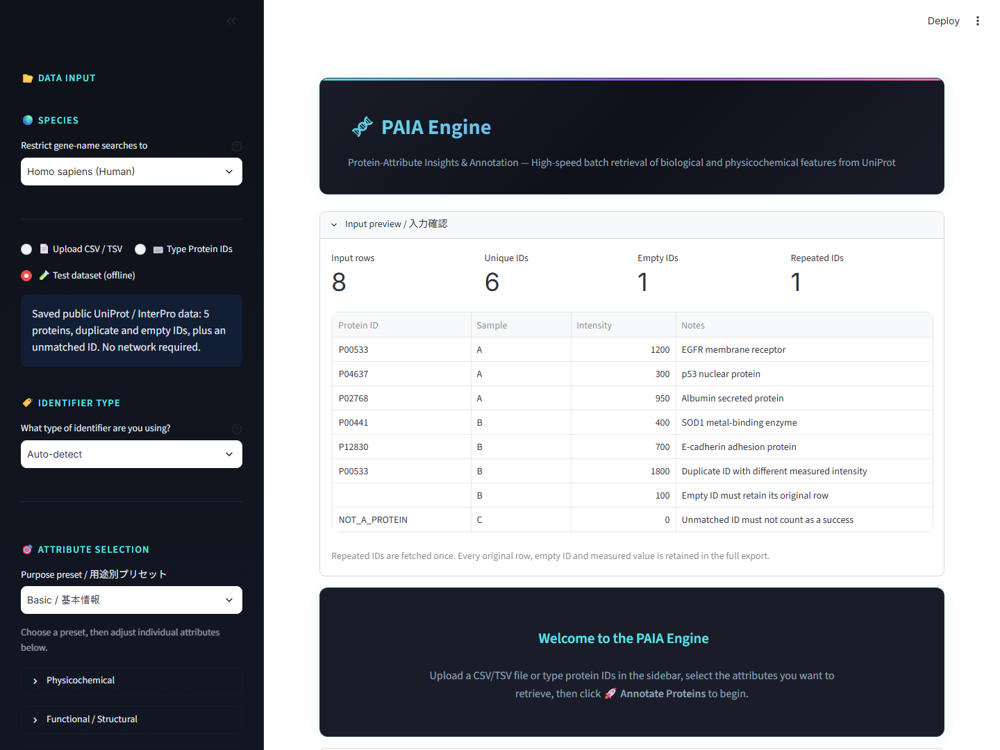

# PAIA Engine

**Python 3.14対応・日本語ガイド付きのタンパク質アノテーションツール**

タンパク質のIDから、UniProtやInterProの公開情報を使って名前・機能・分子量・局在・ドメイン・翻訳後修飾などを取得します。結果を表やグラフで確認し、元の入力行を残したCSVとして保存できます。

このリポジトリは実行ファイル化する前のソース版です。**Python 3.14を使い、必要なライブラリを初回起動時に自動インストールします。**

## 初心者向け：ダウンロードから起動まで

1. このGitHubページの緑色の **Code** をクリックし、**Download ZIP** を選びます。公開リポジトリなのでログイン不要です。
2. ダウンロードしたZIPを右クリックし、**すべて展開** を選びます。
3. 展開先の **PAIA_Manual_JA.html** をダブルクリックすると、実画面と図解付きの詳しい説明書を読めます。Python 3.14があるか確認します。
4. **01_Setup_Libraries.bat** をダブルクリックし、最後の **READY** を確認します。初回はインターネット接続が必要です。
5. **PAIA_Engine_Source.bat** をダブルクリックすると操作画面が開きます。利用中は黒いウィンドウを開いたままにします。
6. 左側の **Test dataset (offline)** と **Basic / 基本情報** を選び、**Annotate Proteins** を押して練習します。
7. **Download Annotated CSV** で結果を保存します。

**ZIPの中から直接起動せず、先にすべて展開してください。**

## 必要なもの

- **Python 3.14の64ビット版**。Windows x64・通常版のPython 3.14.8で検証済みです。Python 3.14が既にあれば入れ直す必要はありません。
- EdgeやChromeなどのブラウザー。
- 初回セットアップと、公開データベースを検索するときのインターネット接続。
- アプリのフォルダーへ書き込める場所と空き容量。

Pythonがまだない場合は [Python公式ダウンロード](https://www.python.org/downloads/windows/) から3.14の64ビット版を用意してください。別のPython版も入っている場合、起動ファイルは3.14を優先して探します。

ライブラリはアプリのフォルダー内の **.venv** に自動で保存します。システム全体のPython環境は変更しません。2回目からは準備済みの環境を使います。セットアップ完了後は、同梱のオフラインテストをネット接続なしでも利用できます。

## 操作ガイド

- [40ページ・152ステップの詳細日本語説明書（PDF）](docs/manual/PAIA_Engine_Detailed_Manual_JA.pdf)
- [詳細説明書（HTML：展開後にダブルクリック）](PAIA_Manual_JA.html)。画像を含む単独ファイルです。手順検索・操作チェック・画像拡大が使えます。
- [入力、結果の確認、絞り込み、CSV保存](docs/USER_GUIDE_JA.md)
- [自動セットアップの仕組みと、困ったときの対処](docs/SOURCE_SETUP_JA.md)
- [Python 3.14での検証結果](docs/SOURCE_VALIDATION_JA.md)
- [練習用CSV](test_data/proteins.csv)



## ダブルクリック用の補助ファイル

| ファイル | 操作 |
|---|---|
| `PAIA_Manual_JA.html` | 詳しい説明書を開く |
| `00_Check_PC.bat` | PC・Pythonの情報を `logs/pc_check.txt` に記録 |
| `01_Setup_Libraries.bat` | Python 3.14を探し、アプリ用ライブラリを専用環境へ自動準備 |
| `PAIA_Engine_Source.bat` | ソース版を起動 |
| `02_Build_Standalone.bat` | ビルド用ライブラリも自動準備し、Python同梱のexe版を作成 |
| `03_Run_With_Log.bat` | 起動しながら `logs/launch.log` を保存 |

Python本体は別途必要です。ライブラリ準備ファイルはPython本体のインストールを行いません。

exe版は `output/standalone/作成日時/PAIA_Engine` に作成されます。`PAIA_Engine.exe` と `_internal` を含むフォルダー全体が必要です。配布用ZIPは同じ作成日時フォルダーの `PAIA_Engine_Standalone.zip` です。ZIPを別の場所にすべて展開して、起動・操作・CSV保存・終了後の再起動を確認してください。

今回のWindows x64 / Python 3.14.8でのビルドと、別フォルダーに展開したexeの操作を確認しています。旧exeが動かなかった別PCは、そのPCで確認が必要です。

## 主な機能

- IDの直接入力、CSV・TSV・Excelの読み込み。
- 用途別プリセットと44項目の取得。
- 複数候補の対応付け確認、生物種の確認。
- 局在・分類・数値・文字列を組み合わせた絞り込み。
- タンパク質ごとの詳細、出典、根拠、取得日時の確認。
- 全件CSV、絞り込みCSV、1件ごとの根拠JSONの保存。
- 保存済みの公開データを使うオフライン練習。

## 結果の意味

注釈の空欄は、根拠のある登録がない状態です。生物学的にその性質がないと確認された意味ではありません。PTM件数0は登録部位がない状態、細胞表面候補は局在などからの候補判定です。元のUniProtページや詳細欄の根拠も確認してください。

オフラインテストでは、入力8行・空欄を除く6種類のIDのうち5種類が一致します。全件CSVには重複と空欄も含め、元の8行が保存されます。

## うまく起動しない場合

- **Python 3.14が見つからない**：3.14がインストールされているか確認します。特殊な場所にある場合の指定方法は[セットアップガイド](docs/SOURCE_SETUP_JA.md)を参照してください。
- **ライブラリのインストールに失敗する**：ネット接続と、組織のプロキシ・証明書の制限を確認して再実行します。
- **ブラウザーが開かない**：黒いウィンドウを開いたまま、アドレス欄に `http://localhost:8501` を入力します。
- **Port 8501 is already in use**：自分で開いた旧アプリを終了します。別番号も指定できます。
- **フォルダーを移動した後に起動できない**：アプリを終了して`.venv`を別名に変更し、起動ファイルを再実行します。元データや出力CSVは残してください。

結果は終了する前に保存し、終了するときはブラウザーのタブと黒い起動用ウィンドウを閉じます。

## 開発用

起動ファイルと同じ準備・起動を手動で行う場合：

```powershell
py -3.14 bootstrap.py
```

インストールだけ行う場合：

```powershell
py -3.14 bootstrap.py --setup-only
```

別のポート番号で起動する場合：

```powershell
py -3.14 bootstrap.py --port 8502
```

ライブラリの一覧は `requirements.txt`、Windows x64・Python 3.14の検証済み構成は `requirements-windows-py314.lock` に記録しています。
