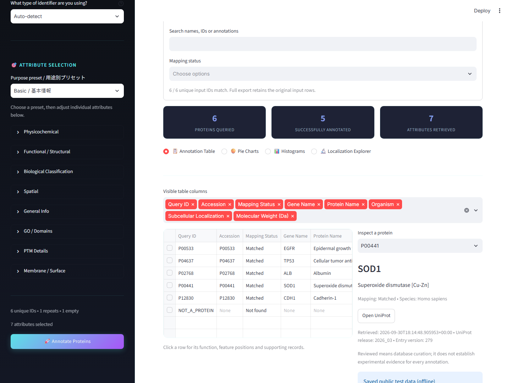

# PAIA Engine 操作ガイド

Python 3.14ソース版のダウンロードと初回セットアップは [README](../README.md) を参照してください。以下では起動後の操作を説明します。

## 1. 最初はオフラインテストで練習する

この操作は、同梱した公開データを使います。新しい検索結果の取得ではなく、操作を練習するための保存データです。

1. 左側の入力欄で **Test dataset (offline)** を選びます。左側が閉じている場合は左上の開閉ボタンで表示します。
2. **Species** は **Homo sapiens (Human)** のままにします。
3. **Identifier Type** は **Auto-detect** のままにします。
4. **Purpose preset / 用途別プリセット** で **Basic / 基本情報** を選びます。
5. **Annotate Proteins** をクリックします。
6. **Annotation Table** に結果が表示されることを確認します。
7. 画面下の **Download Annotated CSV** をクリックして保存します。


入力確認の表示は **Input rows = 8、Unique IDs = 6、Empty IDs = 1、Repeated IDs = 1** になります。検索対象は空欄を除いた6種類のIDで、そのうち5種類が **Matched**、1種類が **Not found** です。

画面の結果表は同じIDをまとめて表示します。全件CSVは元の8行を残し、重複行ごとの測定値とIDが空欄の行も保存します。画面の件数とCSVの行数が違っていても、この例では正常です。

**Test dataset (offline) がない場合は、この説明書より前の版を使っている可能性があります。配布版を確認してください。**

## 2. 自分のタンパク質IDを調べる

### 方法A：IDを直接入力する

1. **Type Protein IDs** を選びます。
2. 入力欄にIDを1行ずつ貼り付けます。カンマ区切りでも入力できます。
3. **Species** で対象の生物種を選びます。ヒトはHuman、マウスはMouseです。
4. IDが混在している場合は **Auto-detect**、UniProtのアクセッション番号だけの場合は **UniProt ID** を選びます。
5. **Basic / 基本情報** などのプリセットを選び、**Annotate Proteins** を押します。

練習用の入力例：

```text
P00533
P04637
P02768
```

| IDの種類 | 入力例 | Identifier Type |
|---|---|---|
| UniProtアクセッション番号 | P00533、P04637 | UniProt ID |
| 遺伝子名・シンボル | EGFR、TP53、ACTB | Gene Name / Symbol |
| タンパク質の名称 | Tumor protein p53 | Protein Name |
| Ensembl ID | ENSG00000141510 | Ensembl ID |
| RefSeq ID | NP_000537.3 | RefSeq ID |

遺伝子名・タンパク質名の検索は選択した生物種に絞られます。**UniProtアクセッション番号の完全一致は、生物種の設定よりIDの一致が優先されます。** 結果の **Organism** と **Species Match** も確認してください。初回は上の3件程度から試すと操作を確認しやすくなります。

### 方法B：ExcelやCSVを読み込む

1. Excelなどで、1行目に列名、2行目以降にタンパク質IDを書きます。
2. **.xlsx**、または **CSV UTF-8** で保存します。TSVもUTF-8で保存してください。CSVは見た目の色やセル書式を保持しない表形式です。
3. **Upload CSV / TSV** を選び、ファイルをドラッグするか **Browse files** から選びます。画面名はCSV / TSVですが、.xlsxも読み込めます。
4. **Select the identifier column** でIDが入った列を選びます。列名は自由です。
5. **Input preview / 入力確認** で列とIDを確認し、生物種・IDの種類・プリセットを設定して実行します。

| Protein ID | Sample | Intensity |
|---|---|---|
| P00533 | A | 1200 |
| P04637 | A | 300 |
| P00533 | B | 1800 |

同じIDが複数行にあっても、そのIDの検索は1回にまとめられます。全件CSVには、読み込んだ表の各行と列を残して注釈を追加します。Excelのシート構成、数式、色、書式を引き継ぐ機能ではありません。元のExcelファイルは別に保管してください。

同梱の [test_data/proteins.csv](../test_data/proteins.csv) でも練習できます。この表の測定値は操作確認用の例です。ファイルのアップロードは通常のオンライン検索になるため、ネット接続なしで試すときは入力方法の **Test dataset (offline)** を使います。

## 3. 調べる項目を選ぶ

| プリセット | 用途 |
|---|---|
| Basic / 基本情報 | 名前、機能、生物種、分子量、配列長、局在を確認する |
| Membrane / 膜・分泌 | 受容体、分泌、膜の領域、細胞表面候補を調べる |
| Enzymes / 酵素 | 酵素、活性部位、GO、ドメインなどを調べる |
| PTM / 翻訳後修飾 | リン酸化、糖鎖、ジスルフィド結合などを調べる |
| Full annotation / 全項目 | 現在の版の44項目すべてを選ぶ |

選んだ後、**Attribute Selection** の各カテゴリを開いて項目を追加・削除できます。**Data sources** には項目の出典説明があります。IDと調べる項目がそれぞれ1つ以上あると実行ボタンが使えます。

入力・生物種・選択項目を変えた後は、**Annotate Proteins** をもう一度押します。設定変更だけでは、前回の結果とダウンロード内容は更新されません。

## 4. 結果とIDの対応を確認する

まず **Identifier mapping / ID対応付けの確認** を開き、IDが意図したタンパク質に対応しているかを確認します。

| 表示 | 意味・次の操作 |
|---|---|
| Matched | 対応先が決まった状態。名前と生物種を確認する |
| Needs review | 複数候補がある状態。名前・生物種・アクセッション番号を確認する |
| Not found | 今回の検索で一致がない。IDのつづりや種類、生物種を確認する |
| Fetch error | 通信などの取得エラー。接続を確認して再実行する |
| Invalid query | 問い合わせが受け付けられなかった状態。IDの表記や種類を確認する |
| Empty input | IDが空欄の入力行。全件CSVに行を残した状態 |

**Needs review** では候補欄から適切なものを選び、**Apply confirmed mappings / 選択した対応を確定** を押します。判断できないときは **Keep unresolved / 未確定のまま** にします。候補一覧に目的のものがなければ、IDをより具体的なものに変更して再実行してください。

結果表の行をクリックするか、**Inspect a protein** でIDを選ぶと、右側に詳細と根拠が表示されます。**Open UniProt** で元の登録ページを開けます。**Inspect annotation** では確認する項目を切り替えられます。



**Visible table columns** は画面に表示する列の選択です。全件CSVの取得項目は削除されません。分子量 **Molecular Weight (Da)** の単位はDa、**Sequence Length** はアミノ酸残基数です。

## 5. 絞り込みとグラフを使う

**Combined filters / 条件を組み合わせて絞り込み** では、局在、分類、数値、文字列、IDの対応状況で絞れます。

- **Subcellular locations**：細胞内外の局在。
- **Positive classifications**：受容体や酵素など、根拠のある分類。
- **Numeric conditions**：分子量などの下限と上限。
- **Search names, IDs or annotations**：名前・ID・注釈を文字で検索。
- **Mapping status**：Matchedなどの対応状況。

異なる条件群はすべて満たす必要があります。局在や分類の選択内では **ANY（いずれか）** または **ALL（すべて）** を選べます。条件を入れるほど表示が減る場合があるため、まず1つずつ試してください。

### 練習：膜にある受容体を探す

1. **Test dataset (offline)** と **Membrane / 膜・分泌** を選び、再実行します。
2. **Subcellular locations** で **Cell membrane** を選びます。
3. **Positive classifications** で **Receptor** を選びます。
4. 結果が **P00533（EGFR）** に絞られることを確認します。
5. **Download filtered CSV** で保存します。元データにはP00533が2行あるため、この例の絞り込みCSVは2行です。

**Pie Charts** は円グラフ、**Histograms** は数値の分布、**Localization Explorer** は局在、**Classification Explorer** は生物学的分類を確認する画面です。必要な項目を取得した場合に表示され、現在の絞り込み結果を使います。ID単位の集計であり、元表の重複行数やIntensityで重み付けした集計ではありません。

## 6. 保存・終了・更新する

| ボタン | 保存内容 |
|---|---|
| Download Annotated CSV | 元の入力行を残した全件の結果。標準ファイル名はpaia_annotated_proteins.csv |
| Download filtered CSV | 複合絞り込みに一致した元の入力行。標準ファイル名はpaia_filtered_proteins.csv |
| Download evidence JSON | 詳細画面で選んだ1件の根拠と取得情報。標準ファイル名はアクセッション番号_evidence.json |

保存先はブラウザーの設定に従います。通常はダウンロードフォルダーです。CSVはExcelで開けます。JSONは詳細な記録を共有・確認するための形式で、初心者の通常操作ではCSVだけでも利用できます。

**結果は、終了する前に保存してください。** 画面を再読み込みしたり起動し直したりすると、結果を再取得する必要が生じることがあります。

終了するときは結果を保存し、ブラウザーのタブと黒い起動用ウィンドウを閉じます。ブラウザーのタブだけを閉じても、起動用ウィンドウが開いていればアプリは動作を続けます。

更新するときはアプリを終了し、新しいZIPを別のフォルダーにすべて展開して起動します。保存したCSVや元データは別に保管し、新版の操作を確認してから旧フォルダーを整理してください。

## 7. 結果を読むときの注意

- **空欄やNo supporting annotation**：根拠のある注釈がない状態です。その性質が生物学的に存在しないと確認された意味ではありません。
- **PTMの件数0**：登録された部位がないという意味です。修飾がないと実験で証明された意味ではありません。
- **Cell Surface Candidate**：局在や膜の向きなどからの候補判定です。細胞表面で実際にアクセスできることを証明するものではありません。
- **Reviewed**：データベースの手動キュレーションを示します。全項目が実験で確認されたことは意味しません。
- **GO**：機能（Molecular Function）、生物学的過程（Biological Process）、細胞内外の場所（Cellular Component）の注釈です。詳細画面の出典や根拠も確認してください。
- **InterPro StatusのFetch error**：InterProを取得できなかった状態です。ドメインが存在しないと判断しないでください。

必要に応じて取得日時、登録の版、根拠、元のUniProtページを確認します。保存データによるオフラインテストは最新の登録内容を保証しません。

## 8. 困ったとき

| 状況 | 確認すること |
|---|---|
| GitHubページが404になる | URLと閲覧権限を配布者に確認。非公開の場合は権限のあるアカウントでログイン |
| 起動ファイルが見つからない | Code → Download ZIPで取得し、すべて展開したフォルダーにPAIA_Engine_Source.batがあるか確認 |
| Pythonが見つからない／ライブラリを準備できない | [自動セットアップのガイド](SOURCE_SETUP_JA.md)に沿って確認 |
| ブラウザーが自動で開かない | 黒いウィンドウを開いたまま、http://localhost:8501をアドレス欄に入力 |
| localhostに接続できない | アプリが終了していないか確認。黒いウィンドウにエラーがあれば記録する |
| Port 8501 is already in use | 同じアプリが既に起動していないか確認。自分で開いた旧ウィンドウを終了して再起動 |
| Annotate Proteinsを押せない | 空欄でないIDと、調べる項目を各1つ以上選択 |
| ファイル読込みエラー・文字化け | Excelでは.xlsxまたはCSV UTF-8で保存し直す。古い.xlsは.xlsxに変換 |
| 結果が0件になる | 絞り込み条件を外して確認。数値の下限が上限を超えていないか確認 |
| 設定を変えても結果が変わらない | Annotate Proteinsをもう一度押して更新 |
| Fetch errorが出る | ネット接続と組織の接続制限を確認。少数のIDで再実行 |
| Test dataset (offline)がない | 説明書に対応する更新版か、ダウンロードした版を確認 |

解決しない場合は、使った版、押したボタン、入力方法、エラー文を配布者に伝えてください。画面を共有する場合は、非公開のIDや測定値が映っていないか確認します。


