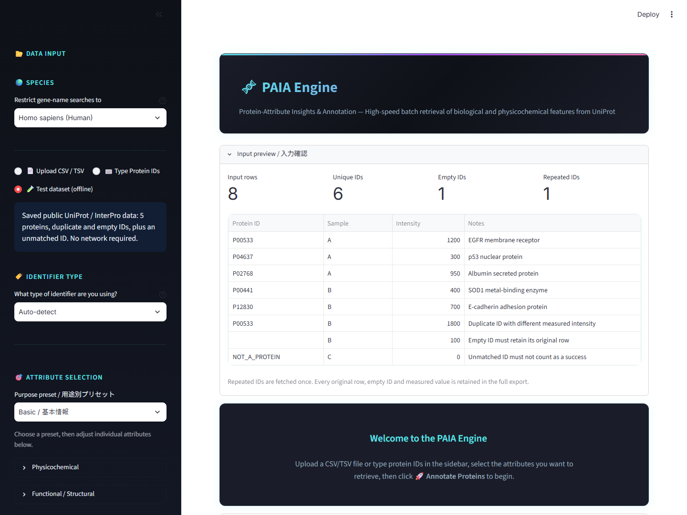
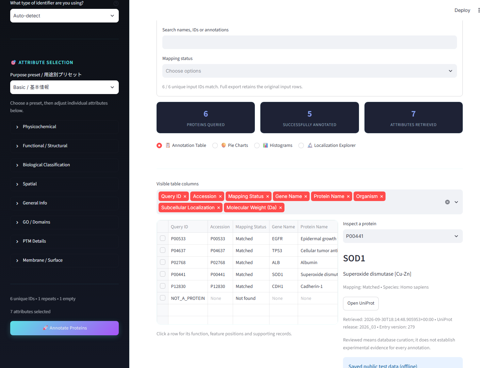

# PAIA Engine 日本語取扱説明書

**GitHubからのダウンロード・起動・基本操作**  
対象：Windows用の更新版（用途別プリセットとオフラインテストを備えた版）  
説明書作成日：2026年10月8日

PAIA Engineは、タンパク質のIDを入力して、UniProtなどの公開データベースから名前、機能、分子量、局在などを調べるソフトです。「アノテーション」とは、IDにこうした説明を付け加えることです。

## まずはこの5手順

1. 配布者から案内されたGitHubページで **Releases** を開き、**Assets** にあるWindows用ZIPをダウンロードします。
2. ZIPを右クリックし、**すべて展開** を選びます。
3. 展開したフォルダー内の **PAIA_Engine.exe** をダブルクリックします。
4. 開いた画面で **Test dataset (offline)** → **Basic / 基本情報** → **Annotate Proteins** を選びます。
5. 結果を確認し、**Download Annotated CSV** で保存します。

**ZIPの中から直接起動せず、必ず先にすべて展開してください。**

印刷用の説明書は [PDF版](../output/pdf/PAIA_Engine_Manual_JA.pdf) です。

## 1. 準備するもの

- 64ビットのWindows PC。本書の操作説明はWindows 11を想定しています。
- ブラウザー（EdgeやChromeなど）。
- インターネット接続。自分のIDで公開データベースを検索するときに使います。同梱のオフラインテストでは不要です。
- 保存用のフォルダーと、ZIPを展開できる空き容量。

Windows用実行ファイル版では、Pythonのインストールやコマンド入力は不要です。本書ではmacOS・Linuxでの起動は扱いません。

## 2. GitHubからダウンロードする

GitHubはソフトの配布にも使われるウェブサイトです。**Releases（リリース）** は配布版の一覧、**Assets（アセット）** はその版に添付されたファイルです。

1. 配布者から案内された **PAIA EngineのGitHubページ** をブラウザーで開きます。同名の別ソフトと取り違えないよう、ページの説明も確認してください。
2. パソコン表示では、ページ右側の **Releases** をクリックします。見つからない場合は画面を広くするか、配布者から案内されたリリースページを開きます。
3. **Latest** と表示された版、または配布者が指定した版を開きます。更新内容も確認します。
4. ページ下部の **Assets** を開きます。閉じている場合は文字や横の矢印をクリックします。
5. Windows用の実行ファイルを含むZIPを選びます。本説明書と一緒に用意した配布ファイル名は **PAIA_Engine_Windows.zip** です。GitHub側で名前が違う場合は、リリースの説明に従ってください。
6. ダウンロード完了を待ちます。通常はパソコンの **ダウンロード** フォルダーに保存されます。

| 表示されるもの | 内容・選び方 |
|---|---|
| PAIA_Engine_Windows.zip | 本説明書に対応した、起動用ファイルを含む配布ZIP |
| Source code (zip) / Source code (tar.gz) | 開発用のソースコード。初心者向けの起動用ZIPとは内容が異なります |
| 緑色のCode → Download ZIP | ソースコードをダウンロードする操作。実行ファイルが同梱されているとは限りません |

公開されているページと公開版のダウンロードは、通常GitHubへのログインなしで利用できます。非公開ページは閲覧権限のあるアカウントでログインする必要があります。404やWindows用ZIPが見つからない場合は、配布者にURL・閲覧権限・配布状況を確認してください。

GitHubでのファイルの探し方は [GitHub公式ヘルプ](https://docs.github.com/en/repositories/releasing-projects-on-github/viewing-your-repositorys-releases-and-tags) も参照できます。

## 3. ZIPを展開して起動する

1. エクスプローラーで **ダウンロード** フォルダーを開きます。
2. ダウンロードしたZIPを右クリックし、**すべて展開** を選びます。Windowsの表示によっては「すべて抽出」と表記されます。
3. 保存先を確認して **展開** を押します。展開が終わるまで待ちます。
4. 展開先で **PAIA_Engine** フォルダーを開きます。フォルダーが二重になっている場合は、次のファイルが見えるところまで開いてください。

```text
PAIA_Engine
├─ PAIA_Engine.exe              ← これをダブルクリック
├─ _internal                   ← 起動に必要。残しておく
├─ はじめにお読みください.txt
├─ PAIA_Engine_取扱説明書_日本語.pdf
└─ サンプル_タンパク質.csv
```

5. **PAIA_Engine.exe** をダブルクリックします。拡張子を表示しない設定では、名前は「PAIA_Engine」、種類は「アプリケーション」と表示されます。
6. 黒い起動用ウィンドウが開き、その後ブラウザーに操作画面が表示されます。利用中は黒いウィンドウを開いたままにします。
7. ブラウザーが自動で開かない場合は、アドレス欄に **http://localhost:8501** を入力してEnterキーを押します。検索欄ではなく、画面上部のアドレス欄に入力してください。

`localhost` は自分のパソコンを指します。画面は手元のPCで動作し、実データの検索時には入力したIDを使ってUniProtやInterProへ問い合わせます。

**フォルダーを移動するときは、_internalを含むPAIA_Engineフォルダー全体を移動してください。** exeだけをデスクトップに移すと起動できません。手軽に開きたい場合はexeのショートカットを作成します。

開発用ファイル一式から使う場合は、同梱の **PAIA_Engine.bat** も起動に使えます。本説明書で用意したWindows用ZIPはexeを直接開く構成です。

ZIPの展開は [Microsoft公式ヘルプ](https://support.microsoft.com/ja-jp/windows/experience/storage-filemanagement/zip-and-unzip-files) も参照できます。

## 4. 最初はオフラインテストで練習する

この操作は、同梱した公開データを使います。新しい検索結果の取得ではなく、操作を練習するための保存データです。

1. 左側の入力欄で **Test dataset (offline)** を選びます。左側が閉じている場合は左上の開閉ボタンで表示します。
2. **Species** は **Homo sapiens (Human)** のままにします。
3. **Identifier Type** は **Auto-detect** のままにします。
4. **Purpose preset / 用途別プリセット** で **Basic / 基本情報** を選びます。
5. **Annotate Proteins** をクリックします。
6. **Annotation Table** に結果が表示されることを確認します。
7. 画面下の **Download Annotated CSV** をクリックして保存します。



入力確認の表示は **Input rows = 8、Unique IDs = 6、Empty IDs = 1、Repeated IDs = 1** になります。検索対象は空欄を除いた6種類のIDで、そのうち5種類が **Matched**、1種類が **Not found** です。

画面の結果表は同じIDをまとめて表示します。全件CSVは元の8行を残し、重複行ごとの測定値とIDが空欄の行も保存します。画面の件数とCSVの行数が違っていても、この例では正常です。

**Test dataset (offline) がない場合は、この説明書より前の版を使っている可能性があります。配布版を確認してください。**

## 5. 自分のタンパク質IDを調べる

### 方法A：IDを直接入力する

1. **Type Protein IDs** を選びます。
2. 入力欄にIDを1行ずつ貼り付けます。カンマ区切りでも入力できます。
3. **Species** で対象の生物種を選びます。ヒトはHuman、マウスはMouseです。
4. IDが混在している場合は **Auto-detect**、UniProtのアクセッション番号だけの場合は **UniProt ID** を選びます。
5. **Basic / 基本情報** などのプリセットを選び、**Annotate Proteins** を押します。

練習用の入力例：

```text
P00533
P04637
P02768
```

| IDの種類 | 入力例 | Identifier Type |
|---|---|---|
| UniProtアクセッション番号 | P00533、P04637 | UniProt ID |
| 遺伝子名・シンボル | EGFR、TP53、ACTB | Gene Name / Symbol |
| タンパク質の名称 | Tumor protein p53 | Protein Name |
| Ensembl ID | ENSG00000141510 | Ensembl ID |
| RefSeq ID | NP_000537.3 | RefSeq ID |

遺伝子名・タンパク質名の検索は選択した生物種に絞られます。**UniProtアクセッション番号の完全一致は、生物種の設定よりIDの一致が優先されます。** 結果の **Organism** と **Species Match** も確認してください。初回は上の3件程度から試すと操作を確認しやすくなります。

### 方法B：ExcelやCSVを読み込む

1. Excelなどで、1行目に列名、2行目以降にタンパク質IDを書きます。
2. **.xlsx**、または **CSV UTF-8** で保存します。TSVもUTF-8で保存してください。CSVは見た目の色やセル書式を保持しない表形式です。
3. **Upload CSV / TSV** を選び、ファイルをドラッグするか **Browse files** から選びます。画面名はCSV / TSVですが、.xlsxも読み込めます。
4. **Select the identifier column** でIDが入った列を選びます。列名は自由です。
5. **Input preview / 入力確認** で列とIDを確認し、生物種・IDの種類・プリセットを設定して実行します。

| Protein ID | Sample | Intensity |
|---|---|---|
| P00533 | A | 1200 |
| P04637 | A | 300 |
| P00533 | B | 1800 |

同じIDが複数行にあっても、そのIDの検索は1回にまとめられます。全件CSVには、読み込んだ表の各行と列を残して注釈を追加します。Excelのシート構成、数式、色、書式を引き継ぐ機能ではありません。元のExcelファイルは別に保管してください。

同梱の **サンプル_タンパク質.csv** でも練習できます。ファイルのアップロードは通常のオンライン検索になるため、ネット接続なしで試すときは入力方法の **Test dataset (offline)** を使います。

## 6. 調べる項目を選ぶ

| プリセット | 用途 |
|---|---|
| Basic / 基本情報 | 名前、機能、生物種、分子量、配列長、局在を確認する |
| Membrane / 膜・分泌 | 受容体、分泌、膜の領域、細胞表面候補を調べる |
| Enzymes / 酵素 | 酵素、活性部位、GO、ドメインなどを調べる |
| PTM / 翻訳後修飾 | リン酸化、糖鎖、ジスルフィド結合などを調べる |
| Full annotation / 全項目 | 現在の版の44項目すべてを選ぶ |

選んだ後、**Attribute Selection** の各カテゴリを開いて項目を追加・削除できます。**Data sources** には項目の出典説明があります。IDと調べる項目がそれぞれ1つ以上あると実行ボタンが使えます。

入力・生物種・選択項目を変えた後は、**Annotate Proteins** をもう一度押します。設定変更だけでは、前回の結果とダウンロード内容は更新されません。

## 7. 結果とIDの対応を確認する

まず **Identifier mapping / ID対応付けの確認** を開き、IDが意図したタンパク質に対応しているかを確認します。

| 表示 | 意味・次の操作 |
|---|---|
| Matched | 対応先が決まった状態。名前と生物種を確認する |
| Needs review | 複数候補がある状態。名前・生物種・アクセッション番号を確認する |
| Not found | 今回の検索で一致がない。IDのつづりや種類、生物種を確認する |
| Fetch error | 通信などの取得エラー。接続を確認して再実行する |
| Invalid query | 問い合わせが受け付けられなかった状態。IDの表記や種類を確認する |
| Empty input | IDが空欄の入力行。全件CSVに行を残した状態 |

**Needs review** では候補欄から適切なものを選び、**Apply confirmed mappings / 選択した対応を確定** を押します。判断できないときは **Keep unresolved / 未確定のまま** にします。候補一覧に目的のものがなければ、IDをより具体的なものに変更して再実行してください。

結果表の行をクリックするか、**Inspect a protein** でIDを選ぶと、右側に詳細と根拠が表示されます。**Open UniProt** で元の登録ページを開けます。**Inspect annotation** では確認する項目を切り替えられます。



**Visible table columns** は画面に表示する列の選択です。全件CSVの取得項目は削除されません。分子量 **Molecular Weight (Da)** の単位はDa、**Sequence Length** はアミノ酸残基数です。

## 8. 絞り込みとグラフを使う

**Combined filters / 条件を組み合わせて絞り込み** では、局在、分類、数値、文字列、IDの対応状況で絞れます。

- **Subcellular locations**：細胞内外の局在。
- **Positive classifications**：受容体や酵素など、根拠のある分類。
- **Numeric conditions**：分子量などの下限と上限。
- **Search names, IDs or annotations**：名前・ID・注釈を文字で検索。
- **Mapping status**：Matchedなどの対応状況。

異なる条件群はすべて満たす必要があります。局在や分類の選択内では **ANY（いずれか）** または **ALL（すべて）** を選べます。条件を入れるほど表示が減る場合があるため、まず1つずつ試してください。

### 練習：膜にある受容体を探す

1. **Test dataset (offline)** と **Membrane / 膜・分泌** を選び、再実行します。
2. **Subcellular locations** で **Cell membrane** を選びます。
3. **Positive classifications** で **Receptor** を選びます。
4. 結果が **P00533（EGFR）** に絞られることを確認します。
5. **Download filtered CSV** で保存します。元データにはP00533が2行あるため、この例の絞り込みCSVは2行です。

**Pie Charts** は円グラフ、**Histograms** は数値の分布、**Localization Explorer** は局在、**Classification Explorer** は生物学的分類を確認する画面です。必要な項目を取得した場合に表示され、現在の絞り込み結果を使います。ID単位の集計であり、元表の重複行数やIntensityで重み付けした集計ではありません。

## 9. 保存・終了・更新する

| ボタン | 保存内容 |
|---|---|
| Download Annotated CSV | 元の入力行を残した全件の結果。標準ファイル名はpaia_annotated_proteins.csv |
| Download filtered CSV | 複合絞り込みに一致した元の入力行。標準ファイル名はpaia_filtered_proteins.csv |
| Download evidence JSON | 詳細画面で選んだ1件の根拠と取得情報。標準ファイル名はアクセッション番号_evidence.json |

保存先はブラウザーの設定に従います。通常はダウンロードフォルダーです。CSVはExcelで開けます。JSONは詳細な記録を共有・確認するための形式で、初心者の通常操作ではCSVだけでも利用できます。

**結果は、終了する前に保存してください。** 画面を再読み込みしたり起動し直したりすると、結果を再取得する必要が生じることがあります。

終了するときは結果を保存し、ブラウザーのタブと黒い起動用ウィンドウを閉じます。ブラウザーのタブだけを閉じても、起動用ウィンドウが開いていればアプリは動作を続けます。

更新するときはアプリを終了し、新しいZIPを別のフォルダーにすべて展開して起動します。保存したCSVや元データは別に保管し、新版の操作を確認してから旧フォルダーを整理してください。

## 10. 結果を読むときの注意

- **空欄やNo supporting annotation**：根拠のある注釈がない状態です。その性質が生物学的に存在しないと確認された意味ではありません。
- **PTMの件数0**：登録された部位がないという意味です。修飾がないと実験で証明された意味ではありません。
- **Cell Surface Candidate**：局在や膜の向きなどからの候補判定です。細胞表面で実際にアクセスできることを証明するものではありません。
- **Reviewed**：データベースの手動キュレーションを示します。全項目が実験で確認されたことは意味しません。
- **GO**：機能（Molecular Function）、生物学的過程（Biological Process）、細胞内外の場所（Cellular Component）の注釈です。詳細画面の出典や根拠も確認してください。
- **InterPro StatusのFetch error**：InterProを取得できなかった状態です。ドメインが存在しないと判断しないでください。

必要に応じて取得日時、登録の版、根拠、元のUniProtページを確認します。保存データによるオフラインテストは最新の登録内容を保証しません。

## 11. 困ったとき

| 状況 | 確認すること |
|---|---|
| GitHubページが404になる | URLと閲覧権限を配布者に確認。非公開の場合は権限のあるアカウントでログイン |
| ReleasesやWindows用ZIPがない | 配布者に公開状況を確認。ソースコードだけでは本書のexe起動手順を使えない |
| exeが見つからない | ZIPをすべて展開したか、内側のPAIA_Engineフォルダーを開いたかを確認 |
| exeを移した後に起動しない／DLLがない | _internalを含めフォルダー全体を再展開。exeだけを移動しない |
| ブラウザーが自動で開かない | 黒いウィンドウを開いたまま、http://localhost:8501をアドレス欄に入力 |
| localhostに接続できない | アプリが終了していないか確認。黒いウィンドウにエラーがあれば記録する |
| Port 8501 is already in use | 同じアプリが既に起動していないか確認。自分で開いた旧ウィンドウを終了して再起動 |
| Annotate Proteinsを押せない | 空欄でないIDと、調べる項目を各1つ以上選択 |
| ファイル読込みエラー・文字化け | Excelでは.xlsxまたはCSV UTF-8で保存し直す。古い.xlsは.xlsxに変換 |
| 結果が0件になる | 絞り込み条件を外して確認。数値の下限が上限を超えていないか確認 |
| 設定を変えても結果が変わらない | Annotate Proteinsをもう一度押して更新 |
| Fetch errorが出る | ネット接続と組織の接続制限を確認。少数のIDで再実行 |
| Windowsの保護警告で起動できない | 配布元と組織の利用ルールを確認し、必要なら配布者・管理者に相談 |
| Test dataset (offline)がない | 説明書に対応する更新版か、ダウンロードした版を確認 |

解決しない場合は、使った版、押したボタン、入力方法、エラー文を配布者に伝えてください。画面を共有する場合は、非公開のIDや測定値が映っていないか確認します。

## 参照した公式ヘルプ

- [GitHub：リリースとタグの表示](https://docs.github.com/en/repositories/releasing-projects-on-github/viewing-your-repositorys-releases-and-tags)
- [GitHub：ソースコードアーカイブのダウンロード](https://docs.github.com/en/repositories/working-with-files/using-files/downloading-source-code-archives)
- [Microsoft：ファイルを圧縮および展開する](https://support.microsoft.com/ja-jp/windows/experience/storage-filemanagement/zip-and-unzip-files)

アプリ固有の手順は、2026年10月8日に手元の更新版の実装とオフラインデータで確認しました。配布先GitHubのURLとリリース公開状況は未確認です。

